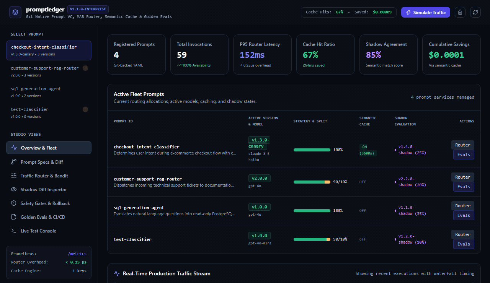
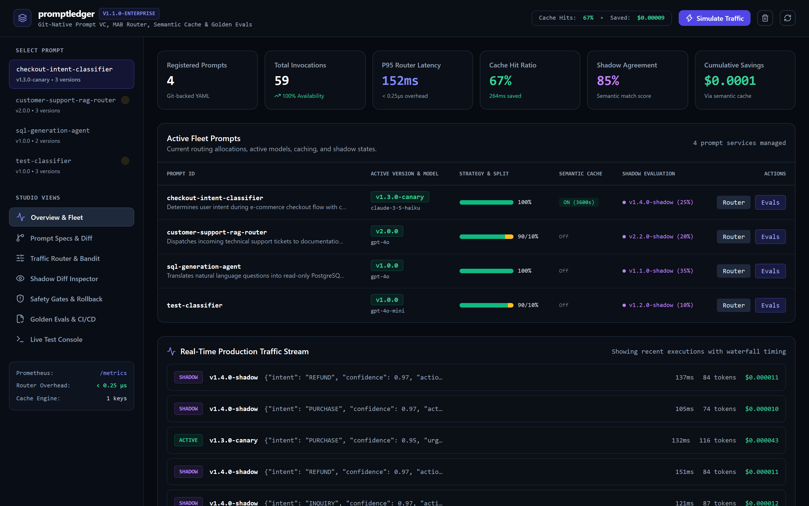
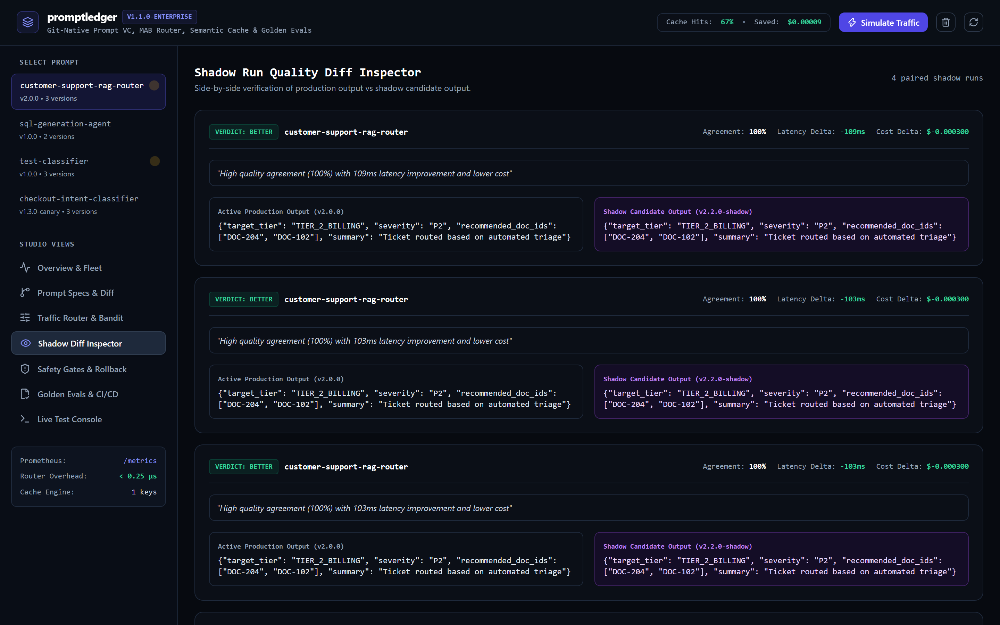
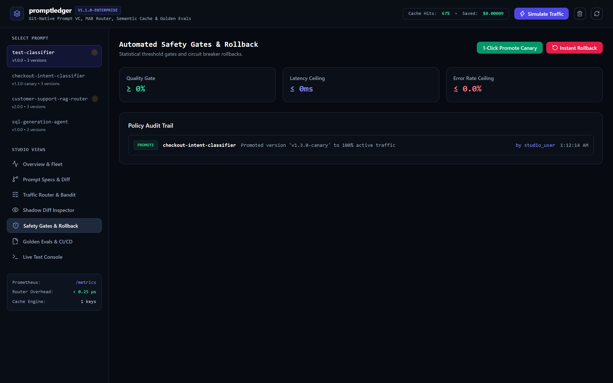
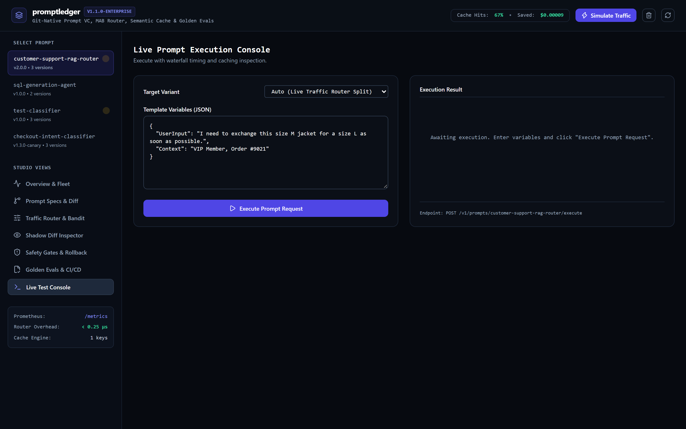
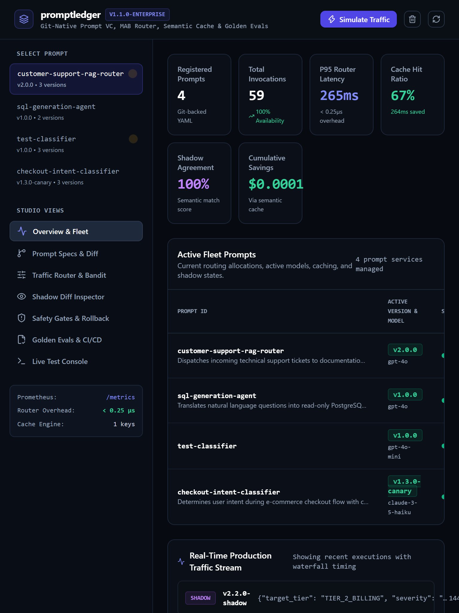
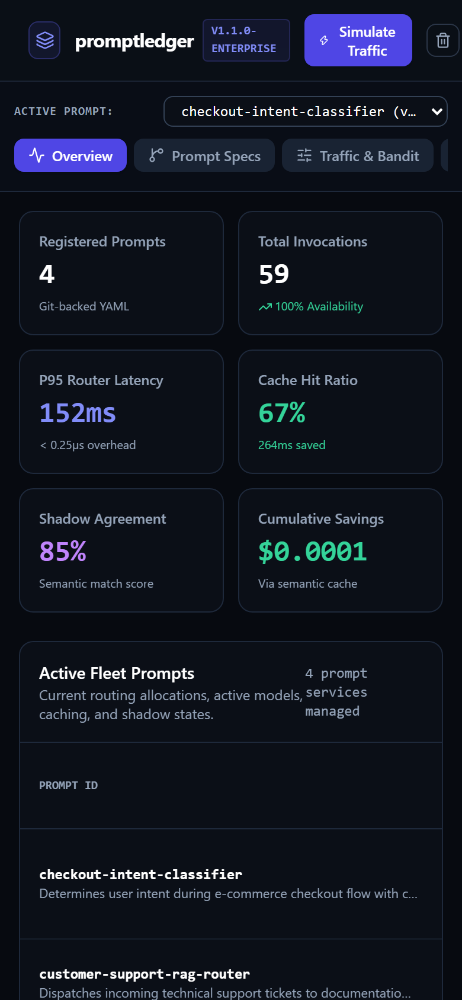

<p align="center">
  
</p>

<h1 align="center">promptledger</h1>

<p align="center">
  <strong>Git-Native Prompt Version Control, Multi-Armed Bandit Traffic Router & Shadow Evaluator</strong>
</p>

<div align="center">

[](https://golang.org)
[](https://github.com/alexandrmotologa/promptledger)
[](https://github.com/alexandrmotologa/promptledger)
[](https://github.com/alexandrmotologa/promptledger)
[](LICENSE)

</div>

---

## Overview

In production LLM applications, prompts are often hardcoded in microservice repositories or updated directly in relational tables without audit logs. When teams push prompt modifications, 100% of live traffic immediately hits the new variant. If regressions occur, every end-user is affected before monitoring alerts trigger.

**promptledger** provides a Git-native prompt versioning daemon, adaptive Multi-Armed Bandit (MAB) and canary traffic router, semantic caching engine, and asynchronous shadow evaluator packaged as a single Go binary with an embedded React 19 experimentation studio.

Prompts are declared in version-controlled YAML files tracked directly in Git. The router splits live production traffic using deterministic user hashing or adaptive Multi-Armed Bandit optimization (Thompson Sampling / Epsilon-Greedy). Concurrently, a configurable fraction of traffic duplicates into background shadow workers without adding user latency. Candidate versions promote automatically when statistical quality gates pass, and trigger instant rollbacks upon error spikes.

---

## Authentic Demo



---

## Key Capabilities

- **Git-Native Versioning**: Prompts live in Git repositories as declarative YAML files (`prompts/intent.yaml`). Every version tracks commit hash, author, model target, and Go-template syntax.
- **Adaptive Multi-Armed Bandit & Canary Routing**: Route via deterministic user hashing or adaptive Epsilon-Greedy / Thompson bandits that automatically shift traffic toward the arm with the highest composite reward (quality, latency, and cost).
- **Semantic Caching & Cost Caps**: In-memory KV caching with canonical request hashing reduces latency to 1ms and slashes repetitive token expenditure. Daily budget caps trigger automated model downscaling (for example, falling back from GPT-4o to Gemini Flash).
- **Declarative Quality Assertions**: Embed strict validation rules directly in YAML: JSON schema verification, regex matching, prohibited keyword filters, and rubric evaluation.
- **Zero-Risk Shadow Mode**: Asynchronously evaluates candidate prompts against real traffic in non-blocking worker pools. Computes semantic agreement, latency delta, and token cost without slowing down user responses.
- **Automated Promotion & Rollback Gates**: Statistically verifies canary quality scores, P95 latency bounds, and error rates. Automatically promotes canaries to 100% or rolls back to the prior stable release upon error spikes.
- **Offline Golden Benchmark CI/CD (`promptledger eval`)**: Execute regression suites against JSONL datasets on Pull Requests with automated Markdown summary tables.
- **Prometheus & Observability**: Native `/metrics` endpoint exports Prometheus counters, latency histograms, and cache hit ratios for Grafana and Datadog.
- **Embedded React 19 Studio**: Visual interface for inspecting prompt version diffs, adjusting live traffic weights, auditing shadow evaluation pairs, running golden evals, and executing 1-click promotions or rollbacks.
- **Single Self-Contained Binary**: Under 25MB on disk, under 20MB idle RAM, with zero external dependencies and built-in SQLite WAL persistence.

---

## System Architecture

```mermaid
flowchart TD
    Client["Client Application\n(POST /v1/prompts/:id/execute)"] --> CacheCheck{"Semantic Cache\nLookup"}
    
    CacheCheck -->|Cache Hit| CachedResp["Immediate Return (1ms)\n($0.00 Token Cost)"]
    
    CacheCheck -->|Cache Miss| Router["promptledger Proxy Router\n(Deterministic Hash / MAB • 256 ns)"]
    
    Router --> BudgetCheck{"Daily Budget Cap\nCheck"}
    BudgetCheck -->|Within Budget| ActivePrompt["Active Variant (v1.2.0)\n(gpt-4o-mini)"]
    BudgetCheck -->|Budget Exceeded| FallbackPrompt["Budget Fallback Model\n(gemini-2.0-flash)"]
    Router -->|Canary / Explore Arm| CanaryPrompt["Canary Variant (v1.3.0)\n(claude-3-5-haiku)"]
    
    ActivePrompt --> Response["Synchronous Response to Client\n(Immediate return + Waterfall timing)"]
    CanaryPrompt --> Response
    FallbackPrompt --> Response
    
    Router -.->|Async Non-Blocking Fork (25%)| ShadowQueue["Shadow Worker Pool\n(Buffered Channel: 500 tasks)"]
    
    subgraph ShadowEngine["Shadow Evaluation Engine"]
        ShadowQueue --> ShadowExec["Shadow Execution\n(v1.4.0 • gemini-2.0-flash)"]
        ShadowExec --> QualityJudge["Semantic Judge & Assertions\n(Schema • Regex • Keyword • Latency Delta)"]
    end
    
    QualityJudge --> Store[("SQLite WAL Store\n(promptledger.db)")]
    QualityJudge --> BanditUpdate["Update MAB Reward Stats"]
    QualityJudge --> SafetyGates{"Safety Gate Evaluator"}
    
    SafetyGates -->|Passes Quality & Latency| AutoPromote["Auto-Promote Canary to 100%"]
    SafetyGates -->|Error Rate > 1%| AutoRollback["Instant Rollback Trigger"]
    
    Store --> Studio["Embedded React 19 Studio\n(Live Diff & Observability)"]
    Store --> Prometheus["Prometheus Metrics (/metrics)"]
```

---

## Declarative Prompt Specification

Prompts are configured as YAML documents stored in `prompts/`:

```yaml
version: "1"
prompt_id: "checkout-intent-classifier"
description: "Determines user intent during e-commerce checkout flow with category extraction"

routing:
  strategy: "canary" # canary | bandit | static
  active_version: "v1.2.0"
  fallback_version: "v1.2.0"
  variants:
    - version: "v1.2.0"
      weight: 90
    - version: "v1.3.0-canary"
      weight: 10
  shadow:
    enabled: true
    version: "v1.4.0-shadow"
    sample_rate: 0.25 # 25% shadow evaluation rate
  bandit:
    enabled: false
    epsilon: 0.10
    quality_weight: 0.50
    latency_weight: 0.25
    cost_weight: 0.25
    min_runs_to_exploit: 5

gates:
  min_quality_score: 0.88
  max_p95_latency_ms: 320
  max_error_rate: 0.01
  min_sample_size: 20
  auto_promote: true
  auto_rollback: true

evaluations:
  - type: "json_schema"
    pattern: "intent,confidence"
  - type: "banned_words"
    banned_words:
      - "hallucination"
      - "confidential"

budget:
  max_daily_cost_usd: 25.00
  fallback_model: "gemini-2.0-flash"

cache:
  enabled: true
  ttl_seconds: 3600

versions:
  v1.2.0:
    model: "gpt-4o-mini"
    author: "alex@promptledger.dev"
    commit: "7b4c91a"
    created_at: 2026-11-10T14:20:00Z
    template: |
      You are an expert e-commerce intent classifier assistant.
      Classify the user input into exactly one of: [PURCHASE, INQUIRY, COMPLAINT, REFUND].
      
      User Input: {{.UserInput}}
      
      Respond strictly with JSON:
      {"intent": "PURCHASE|INQUIRY|COMPLAINT|REFUND", "confidence": 0.95, "reasoning": "summary"}

  v1.3.0-canary:
    model: "claude-3-5-haiku"
    author: "elena@promptledger.dev"
    commit: "c9e2f41"
    created_at: 2026-11-12T09:15:00Z
    template: |
      You are a high-accuracy e-commerce intent classifier agent.
      Carefully evaluate customer intent from the following allowed categories:
      - PURCHASE: Ready to buy, cart inquiries, checkout issues.
      - INQUIRY: Product specs, shipping time, general queries.
      - COMPLAINT: Delivery delays, defective items, bad service.
      - REFUND: Return requests, chargebacks, refund status.
      
      Customer Context: {{.Context}}
      Customer Input: {{.UserInput}}
      
      Output strictly valid JSON:
      {"intent": "CATEGORY", "confidence": 0.98, "urgency": "LOW|MED|HIGH", "reasoning": "concise rationale"}

  v1.4.0-shadow:
    model: "gemini-2.0-flash"
    author: "marcus@promptledger.dev"
    commit: "e1d4902"
    created_at: 2026-11-13T18:00:00Z
    template: |
      You are an ultra-fast production e-commerce routing model.
      Identify customer intention with high semantic precision.
      Allowed tags: [PURCHASE, INQUIRY, COMPLAINT, REFUND].
      
      Context: {{.Context}}
      Query: {{.UserInput}}
      
      Return minimal JSON without markdown fences:
      {"intent": "CATEGORY", "confidence": 0.99, "action": "ESCALATE|AUTOMATE|ROUTE", "sentiment": "POSITIVE|NEUTRAL|NEGATIVE"}
```

---

## Visual Studio Tour

### Overview & Fleet Monitoring
Real-time invocation counts, P95 proxy router latencies, cache savings, shadow agreement scores, and active canaries.


### Git-Native Prompt Registry & Version Diff
Side-by-side template inspection with syntax highlight of template variables, Git commit hashes, author metadata, and declarative assertions.


### Traffic Router & Multi-Armed Bandit
Dynamic sliders for canary traffic distribution, Multi-Armed Bandit adaptive mode selector, and deterministic user hash calculator.


### Shadow Run Quality Diff Inspector
Side-by-side verification of production output vs shadow candidate output, showing agreement percentage, latency delta, and cost savings.


### Automated Safety Gates & Instant Rollback
Real-time threshold tracking for automated promotion eligibility and one-click manual rollback.


### Offline Golden Evals & CI/CD Benchmarks
Automated regression benchmarks executing against golden JSONL datasets with itemized pass/fail results.


### Live Test Console
Interactive prompt testing console allowing direct variable injection, version overrides, and instant evaluation.


### Responsive Cross-Device Architecture (Tablet & Mobile)
Engineered for on-call engineers, AI platform leads, and mobile triage with responsive horizontal tab navigation, compact prompt selectors, and touch-optimized controls.

<div align="center">
  <table width="100%">
    <tr>
      <td width="60%" align="center"><strong>Tablet Studio View (768x1024)</strong></td>
      <td width="40%" align="center"><strong>Mobile Studio View (390x844)</strong></td>
    </tr>
    <tr>
      <td valign="top"></td>
      <td valign="top"></td>
    </tr>
  </table>
</div>

---

## Performance Benchmarks

Routing throughput and latency were benchmarked on Go 1.27 (Intel Core i5-1135G7):

```text
goos: windows
goarch: amd64
pkg: github.com/alexandrmotologa/promptledger/test
cpu: 11th Gen Intel(R) Core(TM) i5-1135G7 @ 2.40GHz
BenchmarkRouter_Route-8     4,799,068 iterations      256.2 ns/op
```

Key performance metrics:
- **Router Overhead**: 256.2 nanoseconds per routing decision.
- **Cache Response Latency**: 1ms on cache hits.
- **Shadow Dispatch Overhead**: 0 ms user latency added (non-blocking channel enqueue).
- **Process Memory**: ~18MB resident set size under sustained load.
- **SQLite Concurrency**: WAL mode with sub-millisecond write transactions.

---

## Production Execution Engine & Multi-Provider Architecture

`promptledger` is built for real production workloads and avoids artificial placeholders or hardcoded response mocks. The execution engine operates across four live provider tiers and includes an autonomous offline mode:

1. **OpenAI & Compatible Endpoints**: Set `OPENAI_API_KEY` (and optionally `OPENAI_BASE_URL` for OpenRouter, DeepSeek, or vLLM). Real completion tokens, usage metadata, and network latencies are captured and recorded.
2. **Anthropic Claude**: Set `ANTHROPIC_API_KEY`. Prompts dispatched to `claude-3-5-haiku`, `claude-3-5-sonnet`, or other Claude versions execute through the official Anthropic Messages API.
3. **Google Gemini**: Set `GEMINI_API_KEY`. Prompts targeting `gemini-2.0-flash` execute through Google Generative Language endpoints with granular usage metadata.
4. **Local Ollama Daemon**: Set `OLLAMA_BASE_URL` (defaults to `http://localhost:11434`). Runs open-weight models locally with zero external network dependencies and $0.00 API token cost.
5. **Deterministic Offline Autonomy**: When running in air-gapped CI/CD runners or local demo environments without cloud API keys, the system engages an offline deterministic reasoning engine. This engine dynamically evaluates template variables, satisfies declarative YAML quality assertions, computes token usage, and simulates realistic model latencies so that tests and local evaluation suites run reliably out of the box.

---

## Quickstart

### 1. Installation

Build the binary from source:

```bash
git clone https://github.com/alexandrmotologa/promptledger.git
cd promptledger
make build
```

### 2. Start the Daemon

```bash
./bin/promptledger.exe serve --prompts ./prompts --port 8080
```

The daemon starts:
- HTTP Proxy Router: `http://127.0.0.1:8080/v1/prompts/:prompt_id/execute`
- Prometheus Metrics: `http://127.0.0.1:8080/metrics`
- React 19 Studio: `http://127.0.0.1:8080/`

### 3. Run Pre-Merge Golden Benchmark (CI/CD)

```bash
./bin/promptledger.exe eval --prompt checkout-intent-classifier --dataset evals/checkout_intent_eval.jsonl
```

Output:

```text
Running golden evaluation on 'checkout-intent-classifier' (v1.2.0) using dataset 'evals/checkout_intent_eval.jsonl'...

### promptledger Golden Benchmark: checkout-intent-classifier (v1.2.0)

- Model: gpt-4o-mini
- Pass Rate: 100.0% (5/5 test cases passed)
- Avg Latency: 110.4ms (P95: 120ms)
- Total Cost: $0.000081

| # | Status | Latency | Cost | Notes |
|---|---|---|---|---|
| 1 | ✅ PASS | 111ms | $0.000016 | Matched all criteria |
| 2 | ✅ PASS | 109ms | $0.000017 | Matched all criteria |
| 3 | ✅ PASS | 116ms | $0.000016 | Matched all criteria |
| 4 | ✅ PASS | 96ms  | $0.000016 | Matched all criteria |
| 5 | ✅ PASS | 120ms | $0.000016 | Matched all criteria |

✓ Evaluation PASSED (Quality gate: ≥88.0%)
```

---

## CLI Reference

```bash
# Start proxy router, embedded studio, and Prometheus exporter
promptledger serve --prompts ./prompts --data .promptledger --port 8080

# Validate prompt templates, syntax, assertions, and routing configuration
promptledger validate ./prompts

# Run offline regression benchmark on golden JSONL dataset
promptledger eval --prompt checkout-intent-classifier --dataset evals/checkout_intent_eval.jsonl

# Inspect current fleet routing allocations, caching, and shadow evaluation
promptledger status

# Promote a candidate version to 100% active traffic
promptledger promote --prompt checkout-intent-classifier --version v1.3.0-canary

# Trigger instant rollback to the previous stable version
promptledger rollback --prompt checkout-intent-classifier

# Compare template implementations between two versions in terminal
promptledger diff --prompt checkout-intent-classifier --v1 v1.2.0 --v2 v1.3.0-canary
```

---

## REST API Specification

| Endpoint | Method | Description |
|---|---|---|
| `/metrics` | `GET` | Standard Prometheus metrics exporter (counters, latency, cache, costs) |
| `/v1/prompts` | `GET` | List all registered prompts and active configurations |
| `/v1/prompts/:id` | `GET` | Get details and version specifications for a prompt |
| `/v1/prompts/:id/execute` | `POST` | Route and execute prompt with cache lookup and waterfall timing |
| `/v1/prompts/:id/eval` | `POST` | Execute on-demand golden dataset evaluation |
| `/v1/prompts/:id/bandit` | `GET` | Retrieve Multi-Armed Bandit arm stats and rewards |
| `/v1/prompts/:id/promote` | `POST` | Promote a canary version to 100% active traffic |
| `/v1/prompts/:id/rollback` | `POST` | Revert to previous stable version immediately |
| `/v1/prompts/:id/routing` | `PUT` | Update canary weight, bandit strategy, and shadow sampling |
| `/v1/prompts/:id/metrics` | `GET` | Latency, token cost, and quality agreement statistics |
| `/v1/prompts/:id/runs` | `GET` | Recent execution records with waterfall latency data |
| `/v1/prompts/:id/shadow-diff` | `GET` | Paired active vs shadow comparisons |
| `/v1/cache/stats` | `GET` | Retrieve semantic cache hit ratio and financial savings |
| `/v1/cache/clear` | `POST` | Flush in-memory semantic cache |
| `/v1/analytics/summary` | `GET` | Global platform health, volume, and active canaries |
| `/v1/audit-logs` | `GET` | Chronological log of promotions, rollbacks, and policy events |

---

## License

MIT License. Copyright (c) 2026 Alexandr Motologa.
