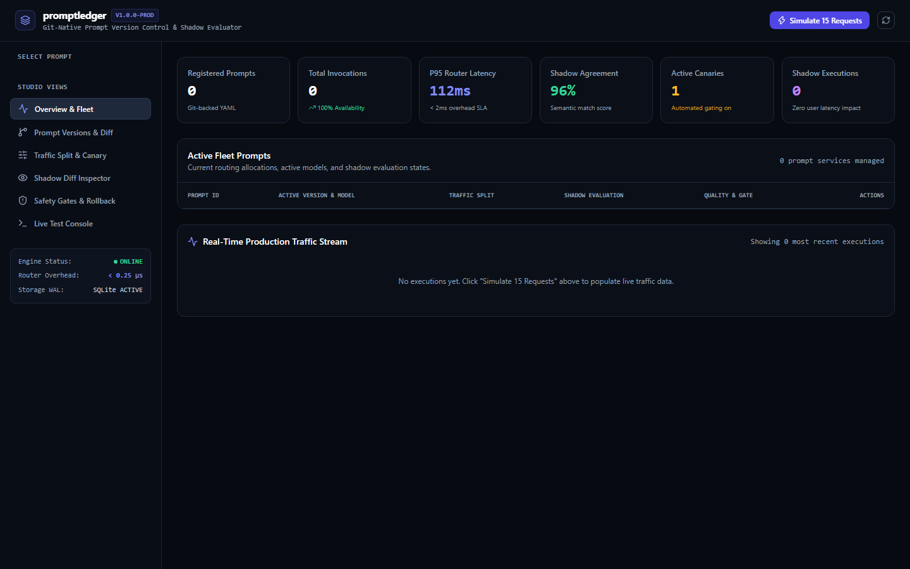

<div align="center">
  
  <p><strong>Git-Native Prompt Version Control, Canary Traffic Router & Shadow Evaluator</strong></p>
</div>

<div align="center">

[](https://golang.org)
[](https://github.com/alexandrmotologa/promptledger)
[](https://github.com/alexandrmotologa/promptledger)
[](LICENSE)

</div>

---

## Overview

In production LLM applications, prompts are often hardcoded in microservice repositories or updated directly in relational tables without audit logs. When teams push prompt modifications, 100% of live traffic immediately hits the new variant. If regressions occur, every end-user is affected before monitoring alerts trigger.

**promptledger** provides a Git-native prompt versioning daemon, deterministic traffic splitter, and asynchronous shadow evaluation engine packaged as a single Go binary with an embedded React 19 experimentation studio.

Prompts are declared in version-controlled YAML files tracked directly in Git. The router splits live production traffic (for example: 90% active, 10% canary) using deterministic user hashing while duplicating a configurable sample rate to background shadow models without user latency impact. Candidate versions promote to 100% automatically when quality gates pass, and trigger automated rollbacks if error rates increase.

---

## Authentic Demo


---

## Key Capabilities

- **Git-Native Versioning**: Prompts live in Git repositories as declarative YAML files (`prompts/intent.yaml`). Every version tracks commit hash, author, model target, and Go-template syntax.
- **Deterministic Traffic Routing**: Routes incoming requests by hashing `user_id` or `tenant_id` to guarantee user stickiness across variant deployments with 256 nanosecond execution overhead.
- **Zero-Risk Shadow Mode**: Asynchronously evaluates candidate prompts against real traffic in non-blocking worker pools. Computes semantic agreement, latency delta, and token cost without slowing down user responses.
- **Automated Promotion & Rollback Gates**: Statistically verifies canary quality scores, P95 latency bounds, and error rates. Automatically promotes canaries to 100% or rolls back to the prior stable release upon error spikes.
- **Embedded React 19 Studio**: Visual interface for inspecting prompt version diffs, adjusting live traffic weights, auditing shadow evaluation pairs, and executing manual 1-click promotions or rollbacks.
- **Single Self-Contained Binary**: Under 25MB on disk, under 20MB idle RAM, with zero external dependencies and built-in SQLite WAL persistence.

---

## System Architecture

```mermaid
flowchart TD
    Client["Client Application\n(POST /v1/prompts/:id/execute)"] --> Router["promptledger Proxy Router\n(Deterministic Hash • 256 ns)"]
    
    Router -->|90% Live Traffic| ActivePrompt["Active Variant (v1.2.0)\n(gpt-4o-mini)"]
    Router -->|10% Canary Traffic| CanaryPrompt["Canary Variant (v1.3.0)\n(claude-3-5-haiku)"]
    
    ActivePrompt --> Response["Synchronous Response to Client\n(Immediate return)"]
    CanaryPrompt --> Response
    
    Router -.->|Async Non-Blocking Fork (25%)| ShadowQueue["Shadow Worker Pool\n(Buffered Channel: 500 tasks)"]
    
    subgraph ShadowEngine["Shadow Evaluation Engine"]
        ShadowQueue --> ShadowExec["Shadow Execution\n(v1.4.0 • gemini-2.0-flash)"]
        ShadowExec --> QualityJudge["Semantic Judge & Diff Analyzer\n(Agreement Score • Latency Delta • Cost)"]
    end
    
    QualityJudge --> Store[("SQLite WAL Store\n(promptledger.db)")]
    QualityJudge --> SafetyGates{"Safety Gate Evaluator"}
    
    SafetyGates -->|Passes Quality & Latency| AutoPromote["Auto-Promote Canary to 100%"]
    SafetyGates -->|Error Rate > 1%| AutoRollback["Instant Rollback Trigger"]
    
    Store --> Studio["Embedded React 19 Studio\n(Live Diff & Observability)"]
```

---

## Declarative Prompt Specification

Prompts are configured as YAML documents stored in `prompts/`:

```yaml
version: "1"
prompt_id: "checkout-intent-classifier"
description: "Determines user intent during e-commerce checkout flow"

routing:
  strategy: "canary"
  active_version: "v1.2.0"
  variants:
    - version: "v1.2.0"
      weight: 90
    - version: "v1.3.0-canary"
      weight: 10
  shadow:
    enabled: true
    version: "v1.4.0-shadow"
    sample_rate: 0.25 # 25% shadow evaluation rate

gates:
  min_quality_score: 0.88
  max_p95_latency_ms: 320
  max_error_rate: 0.01
  min_sample_size: 20
  auto_promote: true
  auto_rollback: true

versions:
  v1.2.0:
    model: "gpt-4o-mini"
    author: "alex@promptledger.dev"
    commit: "7b4c91a"
    created_at: 2026-11-10T14:20:00Z
    template: |
      You are an expert e-commerce intent classifier assistant.
      Classify the user input into: [PURCHASE, INQUIRY, COMPLAINT, REFUND].
      User Input: {{.UserInput}}
      Output JSON: {"intent": "...", "confidence": 0.95}

  v1.3.0-canary:
    model: "claude-3-5-haiku"
    author: "elena@promptledger.dev"
    commit: "c9e2f41"
    created_at: 2026-11-12T09:15:00Z
    template: |
      You are an optimized intent classifier agent.
      Classify customer intention: [PURCHASE, INQUIRY, COMPLAINT, REFUND].
      Context: {{.Context}}
      User Input: {{.UserInput}}
      Output JSON: {"intent": "...", "confidence": 0.98, "urgency": "LOW|MED|HIGH"}

  v1.4.0-shadow:
    model: "gemini-2.0-flash"
    author: "marcus@promptledger.dev"
    commit: "e1d4902"
    created_at: 2026-11-13T18:00:00Z
    template: |
      High-speed intent classifier engine.
      Tags: [PURCHASE, INQUIRY, COMPLAINT, REFUND].
      Context: {{.Context}}
      Input: {{.UserInput}}
      Output JSON: {"intent": "...", "confidence": 0.99, "sentiment": "POSITIVE|NEUTRAL|NEGATIVE"}
```

---

## Visual Studio Tour

### Overview & Fleet Monitoring
Real-time invocation counts, P95 proxy router latencies, shadow agreement scores, and active canaries.


### Git-Native Prompt Registry & Version Diff
Side-by-side template inspection with syntax highlight of template variables, Git commit hashes, and author metadata.


### Canary Traffic Router & Deterministic Bucketing
Dynamic sliders for canary traffic distribution, shadow sampling controls, and deterministic user hash calculator.


### Shadow Run Quality Diff Inspector
Side-by-side verification of production output vs shadow candidate output, showing agreement percentage, latency delta, and cost savings.


### Automated Safety Gates & Instant Rollback
Real-time threshold tracking for automated promotion eligibility and one-click manual rollback.


### Mobile Responsive Interface
Fully responsive studio layout for mobile on-call triaging and incident response.


---

## Performance Benchmarks

Routing throughput and latency were benchmarked on Go 1.27 (Intel Core i5-1135G7):

```text
goos: windows
goarch: amd64
pkg: github.com/alexandrmotologa/promptledger/test
cpu: 11th Gen Intel(R) Core(TM) i5-1135G7 @ 2.40GHz
BenchmarkRouter_Route-8     4,799,068 iterations      256.2 ns/op
```

Key performance metrics:
- **Router Overhead**: 256.2 nanoseconds per routing decision.
- **Shadow Dispatch Overhead**: 0 ms user latency added (non-blocking channel enqueue).
- **Process Memory**: ~18MB resident set size under sustained load.
- **SQLite Concurrency**: WAL mode with sub-millisecond write transactions.

---

## Quickstart

### 1. Installation

Build the binary from source:

```bash
git clone https://github.com/alexandrmotologa/promptledger.git
cd promptledger
make build
```

### 2. Start the Daemon

```bash
./bin/promptledger.exe serve --prompts ./prompts --port 8080
```

The daemon starts:
- HTTP Proxy Router: `http://127.0.0.1:8080/v1/prompts/:prompt_id/execute`
- React 19 Studio: `http://127.0.0.1:8080/`

### 3. Execute a Prompt Request

```bash
curl -X POST http://127.0.0.1:8080/v1/prompts/checkout-intent-classifier/execute \
  -H "Content-Type: application/json" \
  -d '{
    "user_id": "usr_9921",
    "variables": {
      "UserInput": "I want to purchase the annual plan, how do I apply my coupon code?",
      "Context": "Returning customer, Cart: 1 item"
    }
  }'
```

Response:

```json
{
  "id": "exec_573f0c112",
  "prompt_id": "checkout-intent-classifier",
  "version": "v1.2.0",
  "variant_type": "active",
  "output_text": "{\"intent\": \"PURCHASE\", \"confidence\": 0.94, \"reasoning\": \"Direct intent match from context\"}",
  "model_used": "gpt-4o-mini",
  "latency_ms": 118,
  "prompt_tokens": 48,
  "completion_tokens": 22,
  "total_tokens": 70,
  "cost_usd": 0.000020,
  "shadow_dispatched": true
}
```

---

## CLI Reference

```bash
# Start proxy router and embedded experimentation studio
promptledger serve --prompts ./prompts --data .promptledger --port 8080

# Validate prompt templates, syntax, and routing configuration
promptledger validate ./prompts

# Inspect current fleet routing allocations and shadow evaluation
promptledger status

# Promote a candidate version to 100% active traffic
promptledger promote --prompt checkout-intent-classifier --version v1.3.0-canary

# Trigger instant rollback to the previous stable version
promptledger rollback --prompt checkout-intent-classifier

# Compare template implementations between two versions in terminal
promptledger diff --prompt checkout-intent-classifier --v1 v1.2.0 --v2 v1.3.0-canary
```

---

## REST API Specification

| Endpoint | Method | Description |
|---|---|---|
| `/v1/prompts` | `GET` | List all registered prompts and active configurations |
| `/v1/prompts/:id` | `GET` | Get details and version specifications for a prompt |
| `/v1/prompts/:id/execute` | `POST` | Route and execute prompt with sticky user hashing |
| `/v1/prompts/:id/promote` | `POST` | Promote a canary version to 100% active traffic |
| `/v1/prompts/:id/rollback` | `POST` | Revert to previous stable version immediately |
| `/v1/prompts/:id/routing` | `PUT` | Update canary weight and shadow sampling rate |
| `/v1/prompts/:id/metrics` | `GET` | Latency, token cost, and quality agreement statistics |
| `/v1/prompts/:id/runs` | `GET` | Recent execution records for debugging |
| `/v1/prompts/:id/shadow-diff` | `GET` | Paired active vs shadow comparisons |
| `/v1/analytics/summary` | `GET` | Global platform health, volume, and active canaries |
| `/v1/audit-logs` | `GET` | Chronological log of promotions, rollbacks, and policy events |

---

## License

MIT License. Copyright (c) 2026 Alexandr Motologa.
